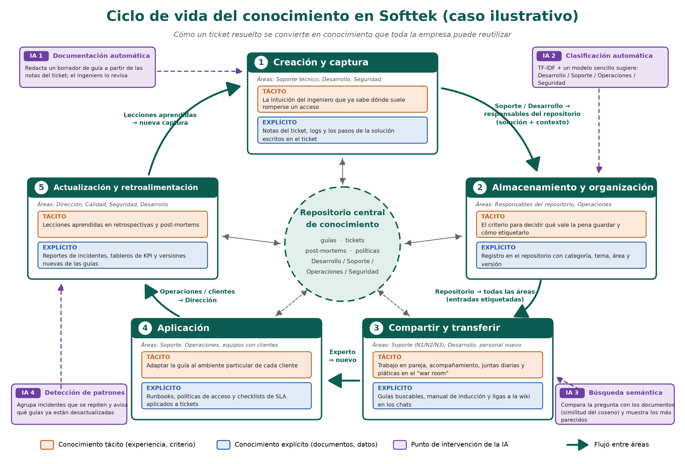
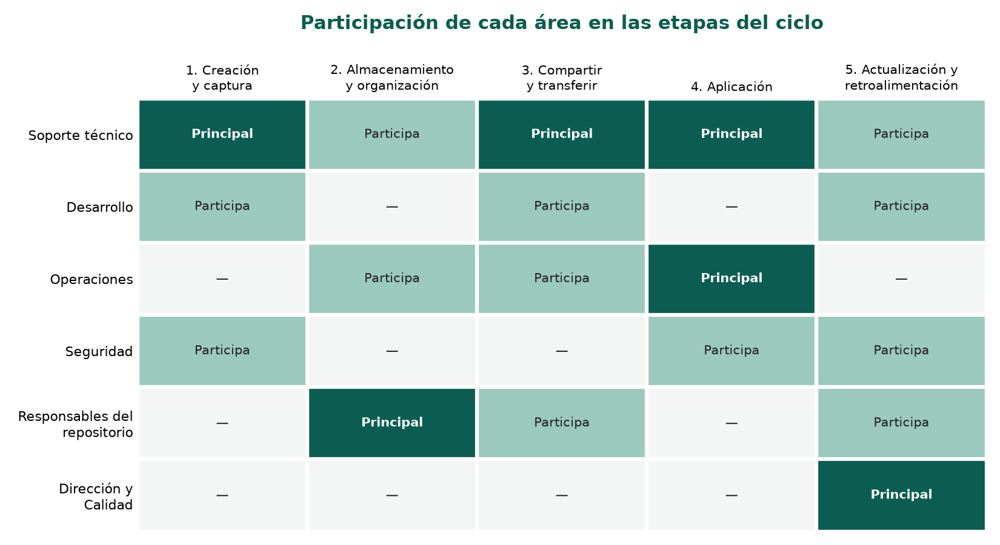
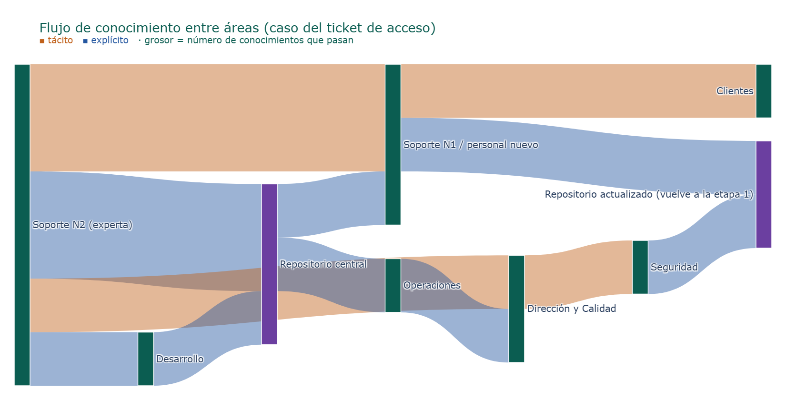
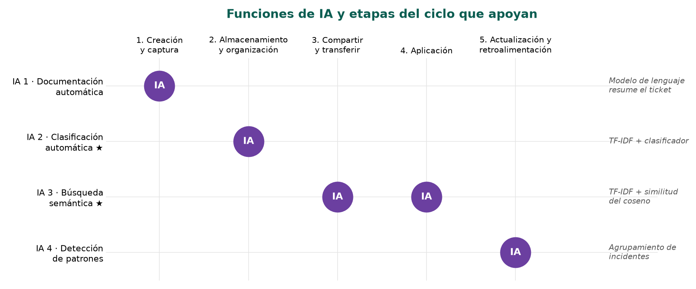

# Actividad 1 · Ciclo de vida del conocimiento en Softtek

Notebook que genera el **diagrama del ciclo de vida del conocimiento** de un caso ilustrativo basado en Softtek y tres gráficas que lo complementan. Para correrlo en Colab: **Entorno de ejecución → Ejecutar todas**. No hay que instalar nada.

> Es un caso ilustrativo: los datos salen de nuestro análisis, no de información interna de Softtek.

## 1. Diagrama del ciclo
Muestra las 5 etapas, los flujos entre áreas, el conocimiento tácito (naranja) y explícito (azul) y los puntos donde interviene la IA (morado).

## 2. Áreas que participan en cada etapa

## 3. Flujo de conocimiento entre áreas (Sankey)
En Colab la gráfica es interactiva: al pasar el mouse sobre una banda se ve qué conocimiento es.

## 4. Funciones de IA por etapa

